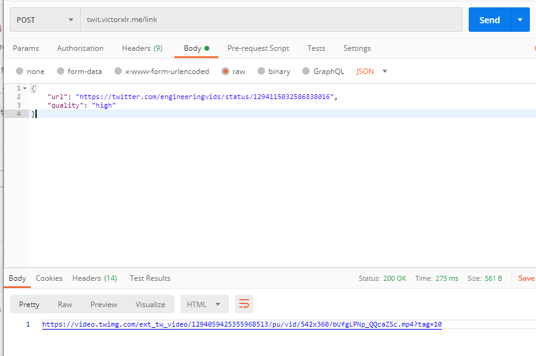

# TwitterDownloader
A quick project to serve mp4 links for apple shortcuts, which allows me to download videos from Twitter.com. Now includes endpoints for posting tweets and managing tweet deletion 


### Generate Token
Create a Twitter developer app using an application's `CONSUMER API KEY` and `CONSUMER API SECRET` keys.. 

Command to run to generate a Bearer Token is 

```bash
curl -u 'API key:API secret key' \
  --data 'grant_type=client_credentials' \
  'https://api.twitter.com/oauth2/token'
```

This App will take a POST request with parameters in the format of 
```json
{
	"url": "https://twitter.com/engineeringvids/status/1294115032586838016",
	"quality": "high"
}
```

and return a direct url to the video so it can be saved to my camera roll :)


### It is currently deployed at
`twit.victorxlr.me/link`



## New Features: Tweet Management

### POST /tweet - Post a Tweet
Post a new tweet to your Twitter account.

**Request:**
```json
{
  "text": "Your tweet text here (max 280 characters)"
}
```

**Example:**
```bash
curl -X POST http://localhost:3000/tweet \
  -H "Content-Type: application/json" \
  -d '{"text": "Hello from the API!"}'
```

**Response:**
```json
{
  "success": true,
  "tweet": {
    "id": "1234567890",
    "text": "Hello from the API!"
  }
}
```

### DELETE /tweet/all - Delete All Tweets
Delete all tweets and retweets from your account. This operation handles rate limiting automatically and provides detailed progress tracking.

**Example:**
```bash
curl -X DELETE http://localhost:3000/tweet/all
```

**Response:**
```json
{
  "success": true,
  "summary": {
    "deletedTweets": 150,
    "deletedRetweets": 45,
    "total": 195,
    "errors": 0
  }
}
```

### Standalone Deletion Script
For more detailed progress tracking and better rate limit handling, use the standalone script:

```bash
node src/deleteAllTweets.js
```

This script provides real-time progress updates and automatically handles Twitter API rate limits with intelligent retry logic.

## Setup

1. Copy `.env` file and add your Twitter API credentials
2. See [TWITTER_API_SETUP.md](./TWITTER_API_SETUP.md) for detailed instructions on obtaining API credentials
3. Install dependencies: `npm install`
4. Start the server: `npm start`

## Environment Variables Required

```bash
# For video download functionality
TOKEN=your_bearer_token

# For tweet posting and deletion
TWITTER_API_KEY=your_api_key
TWITTER_API_SECRET=your_api_secret
TWITTER_ACCESS_TOKEN=your_access_token
TWITTER_ACCESS_SECRET=your_access_secret
```
